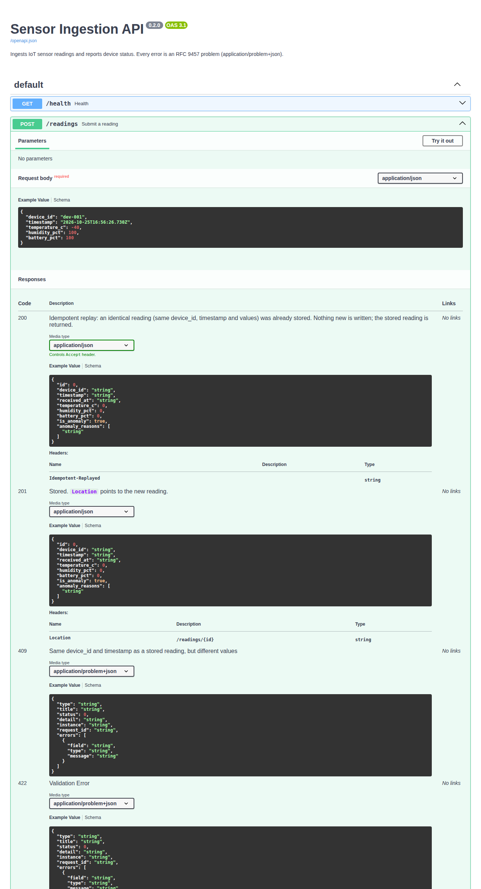
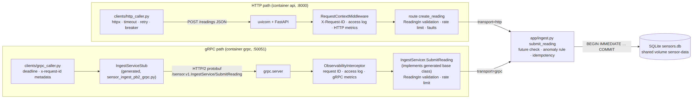
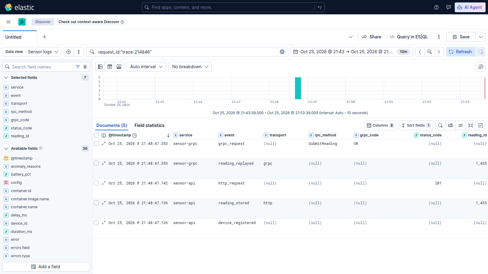
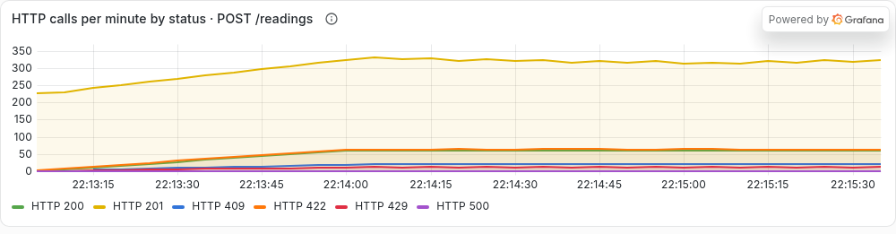
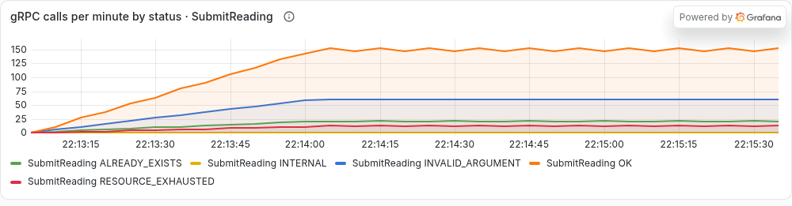
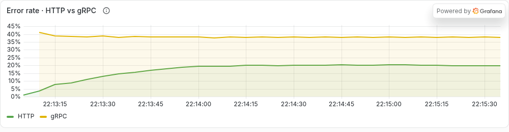
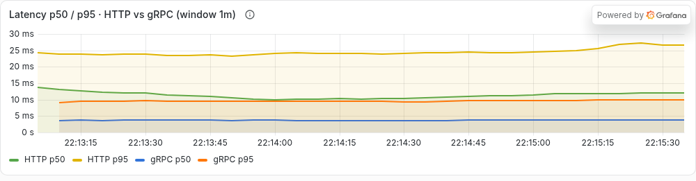
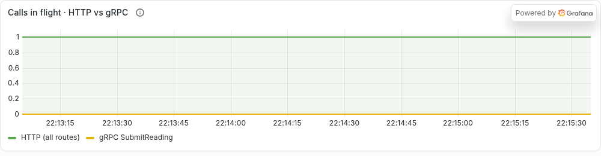
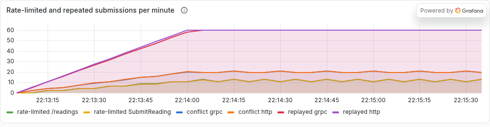

# IoT Sensor Ingestion Service: HTTP APIs, gRPC and metrics

Enterprise Software Development, Fall 2026, Assignment 2. Individual submission by Muhammad Affan.

- **Extends Assignment 1**, which is frozen at git tag `a1-submission` (its report is `REPORT.md` at that tag). A1 built the sensor ingestion API, the simulator, Prometheus/Grafana metrics and the Filebeat → Elasticsearch → Kibana logs. This report covers only what A2 adds.
- **Run and test:** [README.md](README.md), section *Assignment 2*.
- **Design decisions** (choice, reason, rejected alternative): [docs/DECISIONS.md](docs/DECISIONS.md).
- **Raw outputs** behind every number here: [docs/results/](docs/results/).

---

## A. Improving the HTTP API

### A.1 REST constraints

| Constraint | Plain-language meaning | In this API |
|---|---|---|
| **Client–server** | The client (UI, caller) and the server (data, rules) are separate and evolve independently | The dashboard, the simulator and the Python callers only use the public JSON API; the server owns SQLite and the anomaly rules |
| **Stateless** | Each request carries everything needed to handle it; the server keeps no session between requests | No sessions or cookies. A retry of `POST /readings` is understood from its body alone (device + timestamp) |
| **Cacheable** | Responses say whether they may be reused, so clients/proxies can avoid repeat requests | **Not demonstrated**: no `Cache-Control`/`ETag` headers. Readings change every few seconds, so caching `GET /devices` would show stale status |
| **Uniform interface** | Resources named by URIs, manipulated with standard methods, self-describing messages | Plural nouns (`/readings`, `/devices/{id}`), standard methods and status codes, `Location` on create, one error format (`application/problem+json`) |
| **Layered system** | A client can't tell whether it talks to the server directly or through intermediaries | Prometheus scrapes and Filebeat ships logs without the clients knowing; a reverse proxy could be added in front without client changes |
| **Code on demand** (optional) | The server may send executable code to extend the client | **Not demonstrated** by the API. (The dashboard's JavaScript is a static file, not something the API sends to extend a client.) |

### A.2 Endpoint review

Applied to every application endpoint (not `/health` or `/metrics`): plural-noun paths, GET for reads, POST to create, PUT/DELETE for the operator's fault config; input validated by Pydantic models and typed path/query parameters; and **one error format for every error**, RFC 9457 problem details:

```json
{"type":"urn:sensor-api:problem:reading-conflict","title":"Conflict","status":409,
 "detail":"device dev-902 already has a different reading at 2026-10-25T16:44:17.155Z (reading 484)",
 "instance":"/readings","request_id":"ex-4149"}
```

`request_id` matches the `X-Request-ID` header, so any error can be found in the logs. 422s add `errors: [{field, type, message}]`. Before A2 the API had three shapes: a string `detail` (404), a list `detail` (422) and a hand-written string (500). (Code: [app/problems.py](app/problems.py), handlers in [app/main.py](app/main.py), the 500 path in [app/middleware.py](app/middleware.py).)

### A.3 The user task: a device submits a reading (`POST /readings`)

| | Before (A1) | Problem | Change (A2) | Reason |
|---|---|---|---|---|
| Retries | Every POST inserted a row | A device or caller retrying after a timeout stored the reading twice and double-counted `reading_count` | **Idempotent on `(device_id, timestamp)`**: an identical repeat returns `200` + the stored reading (`Idempotent-Replayed: true`); same key, different values → `409` | A device can't take two readings at the same instant, so the body already identifies itself; a retry is now safe |
| Errors | 422 `{"detail":[…]}`, 500 `{"detail":"…"}` | Callers had to parse different shapes | `application/problem+json` everywhere | One branch-able format, with the request ID |
| Load control | None | One misbehaving device could flood the API | Per-device token bucket → `429` + `Retry-After` | Protects the service and the other devices |
| Created resource | `201` with no `Location`, no way to fetch a reading | Not addressable | `Location: /readings/{id}` and `GET /readings/{id}` | Uniform interface |
| Documentation | OpenAPI listed only 201 and FastAPI's default 422 shape | The spec didn't match the real responses | Spec declares 200/201/409/422/429/500 with their real schemas and headers | A contract callers can rely on |

**Other endpoints.** Changed: `GET /devices/{device_id}` and `/devices/{device_id}/readings` now validate the ID (`/devices/abc` is `422`, not a misleading `404`), and all errors are problems. New: `GET /readings/{id}`. Left alone: `GET /devices`, `GET /anomalies` (already resource-style and safe; `limit` already validated 1–500) and `GET|PUT|DELETE /admin/faults` (PUT replaces the whole config and DELETE resets it, so both are already idempotent).

**Callers updated:** the dashboard ([app/static/app.js](app/static/app.js): reads `errors[]`, treats `200` as stored), the simulator (counts `200` replays and `429`s) and `scripts/load.py` (`--devices` spreads load so it stays under the per-device limit).

**Tests** ([tests/test_idempotency.py](tests/test_idempotency.py), [test_rate_limit.py](tests/test_rate_limit.py), [test_readings.py](tests/test_readings.py)): valid → `201` + `Location`; invalid → `422` problem with `errors`; **repeated → `200`, one row, `reading_count` 1**; changed repeat → `409`; 6th reading in a burst → `429`, `Retry-After: 1`. Live run ([docs/results/a_http_examples.txt](docs/results/a_http_examples.txt)):

| Request | Response |
|---|---|
| valid reading for dev-902 | `201 Created`, `location: /readings/484` |
| the same request again | `200 OK`, `idempotent-replayed: true`, same body (id 484) |
| same device + timestamp, temperature 30 | `409 Conflict`, `application/problem+json` |
| humidity 150 and device `sensor-1` | `422`, `errors` lists `device_id` and `humidity_pct` |

### A.4 OpenAPI

The OpenAPI Specification is a standard, machine-readable (JSON/YAML) description of an HTTP API: its paths, methods, parameters, request and response schemas, status codes and headers. It's the API's contract: people read it as documentation (Swagger UI), and tools use it to generate clients, validate requests and responses, and test the API against it.

The spec is [docs/openapi.json](docs/openapi.json), generated from the code by `scripts/export_openapi.py`; [tests/test_openapi.py](tests/test_openapi.py) fails if it drifts from the app, and checks that `POST /readings` declares exactly the statuses it returns (200, 201, 409, 422, 429, 500), with `Retry-After` on 429 and every error as `application/problem+json`. I used it in Swagger UI (http://localhost:8000/docs) to inspect `POST /readings`:



*The 200 (replay, with the `Idempotent-Replayed` header) and 201 (with `Location`) responses return a reading; 409 and 422 are `application/problem+json`; 429 and 500 follow further down.*

### A.5 Rate limiting

- **Limit:** `POST /readings`, a token bucket **per `device_id`**: a burst of 5, refilled at 1 per second ([app/ratelimit.py](app/ratelimit.py), settings `RATE_LIMIT_BURST`/`RATE_LIMIT_PER_S`).
- **Who shares it:** every caller sending readings for the same device (not per IP: behind Docker every caller has the same IP). Other devices are unaffected. Single instance: the state is in the API process's memory (the gRPC server has its own buckets).
- **When calls are allowed again:** after `Retry-After` seconds, when the next token has been refilled.

[scripts/rate_limit_demo.sh](scripts/rate_limit_demo.sh) ([output](docs/results/a_rate_limit_demo.txt)): requests 1–5 → `201`; 6 and 7 (all seven sent within 0.3 s) → `429` with `Retry-After: 1` and a `rate-limited` problem body; after sleeping 1 s, request 8 → `201`.

### A.6 The Python caller: timeout, retry, circuit breaker

[clients/http_caller.py](clients/http_caller.py) calls `POST /readings` like another service would.

| Setting | Value | Why |
|---|---|---|
| Timeout | 2 s per attempt | Normal p95 is about 25 ms (C.3), so 2 s only fires when something is really wrong |
| Retry | at most 3 attempts; backoff 0.2 s, 0.4 s (+ up to 0.1 s jitter); same `X-Request-ID` on every attempt | Only on timeout, connection error or 5xx. **Safe only because the endpoint is idempotent.** 4xx is never retried, and the caller reports it as `REFUSED`, not OK |
| Circuit breaker | opens after 3 consecutive failed attempts; while open, calls fail at once without being sent; after 10 s one trial call (half-open) closes it on success | Stops hammering a sick server and fails fast |

The demo (`--demo`, simulator stopped; faults switched with `/admin/faults`), from [docs/results/a_caller_demo.txt](docs/results/a_caller_demo.txt):

| Phase | What happened |
|---|---|
| 1. healthy | calls 1–2: `201` in 7–27 ms |
| 2. every 2nd request fails with 500 | call 3 `201`; call 4: attempt 1 `HTTP 500`, retried after 0.28 s, attempt 2 `201` |
| 3. every request delayed 3 s (> 2 s timeout) | call 5: three timeouts, then `breaker: closed -> open`; calls 6–8: `circuit open, not sent; trial allowed in 9.0 / 8.0 / 7.0 s` |
| 4. faults off, recovery period over | call 9: `open -> half_open -> closed`, `201`; call 10: `201` |

**Why idempotency matters here:** call 5 timed out on the client, but the server finished it. The API's log for that request ID ([a_caller_call5_server_log.txt](docs/results/a_caller_call5_server_log.txt)) shows the first attempt stored reading 6253 after 3,022 ms, and both retries returned `reading_replayed` (`200`), not new rows. The device gained 7 readings in the run, not 9. Without A.3, the retries would have created duplicates.

---

## B. gRPC service

### B.1 What was built

- **Operation:** `SubmitReading`, the gRPC version of the chosen task, unary (devices send one reading at a time).
- **`.proto`:** [proto/sensor_ingest.proto](proto/sensor_ingest.proto). The numbers are `optional double`, so a missing field is detected instead of silently arriving as `0.0`; the timestamp is an ISO-8601 string so the same validator as HTTP checks it.
- **Generation:** [scripts/gen_proto.sh](scripts/gen_proto.sh), which runs `python -m grpc_tools.protoc -I proto --python_out=app/grpc_gen --pyi_out=app/grpc_gen --grpc_python_out=app/grpc_gen proto/sensor_ingest.proto` and makes the generated import package-relative. The output in `app/grpc_gen/` is committed.
- **Server:** [app/grpc_server.py](app/grpc_server.py), a new Compose service `grpc` (same image, `127.0.0.1:50051`). `IngestServicer` implements the generated `IngestServiceServicer` base class.
- **Same rules, same source of truth, not a wrapper:** both transports call [app/ingest.py](app/ingest.py) `submit_reading()` (future-timestamp check, anomaly rule, idempotency, logs, business metrics), validate with the same `ReadingIn` model, and write to the same SQLite file on the shared `sensor-data` volume. The gRPC server never calls the HTTP API. Test `test_same_rules_and_database_as_http` stores a reading over HTTP, then sends it over gRPC: it's a replay of the same row, and a changed copy gets `ALREADY_EXISTS`.
- **Client:** [clients/grpc_caller.py](clients/grpc_caller.py) takes the reading from command-line flags, sets a deadline (default 2 s), sends `x-request-id` metadata, and prints the reading or the status code and details, plus the request ID the server echoed.

### B.2 Call paths



*Source: [docs/diagrams/call-paths.mmd](docs/diagrams/call-paths.mmd). The gRPC client calls the generated `IngestServiceStub`, which serializes the request to protobuf and sends it over HTTP/2 to `/sensor.v1.IngestService/SubmitReading`; the server's interceptor runs first (like the HTTP middleware), then the generated base class dispatches to `IngestServicer.SubmitReading`. Both paths meet in `submit_reading`. The updated architecture is in [docs/diagrams/architecture.png](docs/diagrams/architecture.png).*

### B.3 One success and one failure through each version

From [scripts/both_transports.sh](scripts/both_transports.sh) ([output](docs/results/b_both_transports.txt)):

| | HTTP | gRPC |
|---|---|---|
| Success | `201 Created`, body = reading 1430 | `OK`, reading 1433 |
| Failure (humidity 150) | `422 Unprocessable Entity`, problem with `errors: [{field: humidity_pct, type: less_than_equal}]` | `INVALID_ARGUMENT`, details `humidity_pct: Input should be less than or equal to 100` |

**The statuses.** HTTP puts the outcome in the response status line (`201` = a resource was created; `422` = the body is well-formed JSON but its values are invalid) and the explanation in the body. gRPC always answers over HTTP/2 with status 200 and puts the RPC outcome in the `grpc-status` trailer: `OK`, or a code from a fixed list of 17 plus a details string. The mapping: 201/200 → `OK` (`replayed=true` for a repeat), 422 → `INVALID_ARGUMENT`, 409 → `ALREADY_EXISTS`, 429 → `RESOURCE_EXHAUSTED` (with `retry-after` in the trailing metadata), 500 → `INTERNAL`. A client deadline that expires gives `DEADLINE_EXCEEDED` on the client (tested).

### B.4 Logs and correlation across the gRPC boundary

`ObservabilityInterceptor` does for gRPC what A1's `RequestContextMiddleware` does for HTTP: it reads `x-request-id` from the call metadata (same regex; invalid or missing → a new UUID), puts it in the same `request_id_var`, so every log line of the call carries it, echoes it in the response metadata, and writes one `grpc_request` access line (`rpc_method`, `grpc_code`, `duration_ms`). Filebeat now also collects the `grpc` container, and the index template maps the new fields.

The script sends one reading over HTTP and repeats it over gRPC with the **same** request ID, `trace-214846`. Searching it in Kibana returns lines from both services:



*Five documents: `sensor-api` registered the device, stored reading 1435 (`transport: http`) and logged `http_request` 201; 211 ms later `sensor-grpc` logged `reading_replayed` for the same reading 1435 (`transport: grpc`) and `grpc_request` OK. One ID follows the reading across both processes, and the replay proves both share one database.*

---

## C. Metrics

### C.1 Audit of the A1 metrics

| A1 metric | Verdict | Action |
|---|---|---|
| `sensor_http_requests_total{method,route,status_code}`, `sensor_http_request_duration_seconds` | Useful: RED for HTTP | Kept; the HTTP half of the comparison |
| `sensor_http_requests_in_progress` | Useful, with a caveat found in A2: it's read during the `/metrics` request itself, so its floor is 1 | Kept; documented on the panel |
| `sensor_readings_total{outcome}` | Useful, but couldn't tell HTTP from gRPC, nor see retries | **Fixed:** added `transport` (http/grpc) and outcomes `replayed`, `conflict` |
| `sensor_reading_validation_errors_total`, `sensor_anomalies_total`, `sensor_devices`, fault metrics | Useful | Kept |
| `sensor_db_write_duration_seconds` (Summary) | **Broken by A2**: now two processes write, and a Summary can't be aggregated across processes (no buckets) | **Fixed:** now a Histogram; the panel shows average + p95 over both |
| — | **Missing:** anything about gRPC, rate limiting, or idempotent repeats | **Added** (C.2) |

### C.2 New metrics

All measured **on the server** (the caller has no metrics endpoint), so HTTP and gRPC are measured the same way. Prometheus scrapes the gRPC process as job `sensor-grpc` (`grpc:9101`, [prometheus.yml](monitoring/prometheus/prometheus.yml)); all labels come from small fixed sets: never device, user, request or trace IDs.

| Metric | Purpose | Type · unit | Labels | Code | Query (Grafana) |
|---|---|---|---|---|---|
| `sensor_grpc_requests_total` | Calls and errors per RPC and status | Counter · calls | `method` (RPC name), `code` (gRPC status name) | `ObservabilityInterceptor`, [app/grpc_server.py](app/grpc_server.py) | `sum by (method, code) (increase(sensor_grpc_requests_total[1m]))`; error rate: `sum(rate(…{code!="OK"}[1m])) / sum(rate(…[1m]))` |
| `sensor_grpc_request_duration_seconds` | Latency distribution, comparable with HTTP | Histogram · seconds, **same buckets as HTTP** (5 ms … 5 s, dense 10–40 ms) | `method` | same | `histogram_quantile(0.95, sum by (le) (rate(sensor_grpc_request_duration_seconds_bucket{method="SubmitReading"}[1m])))` |
| `sensor_grpc_requests_in_progress` | Calls being handled now (pile-up when slow) | Gauge · calls | `method` | same | `sum(sensor_grpc_requests_in_progress{method="SubmitReading"})` |
| `sensor_rate_limited_total` | How often the limiter refuses | Counter · requests | `route` (`/readings` or `SubmitReading`) | `create_reading` in [app/main.py](app/main.py); `SubmitReading` | `sum by (route) (increase(sensor_rate_limited_total[1m]))` |
| `sensor_readings_total` (changed) | Outcomes per transport, incl. idempotent repeats | Counter · readings | `transport`, `outcome` (+ `replayed`, `conflict`) | [app/ingest.py](app/ingest.py) | `sum by (transport, outcome) (increase(sensor_readings_total{outcome=~"replayed\|conflict"}[1m]))` |

**In-flight rather than message size:** a `SubmitReading` request is a constant ~100 bytes, so a size histogram would be one flat line. In-flight calls show the failure that matters (calls piling up when the server or database slows down).

### C.3 Dashboard evidence

`scripts/a2_traffic.py --rounds 150` sent, per second over each transport, a valid reading, the same reading again, an invalid one, a conflicting one every 3rd round, and a 7-reading burst every 10th round. It's deterministic: the client counted **HTTP 201 × 225, 200 × 150, 422 × 150, 409 × 50, 429 × 30** and **gRPC OK × 375 (225 stored + 150 replays), INVALID_ARGUMENT × 150, ALREADY_EXISTS × 50, RESOURCE_EXHAUSTED × 30** ([output](docs/results/c_traffic_run.txt)). The new Grafana row *Submit a reading: HTTP vs gRPC* (dashboard `sensor-service`), over the run (17:13:05–17:15:35 UTC):




*Calls per minute by status: the gRPC panel levels off at 150 OK, 60 INVALID_ARGUMENT, 20 ALREADY_EXISTS and about 12 RESOURCE_EXHAUSTED per minute, which is the script's mix. HTTP has the same mix on top of the simulator's ~4 readings/s of `201`.*



*Non-success share: gRPC ~38 %, HTTP ~20 %. The difference isn't the transport: HTTP also carries the simulator's successful traffic, which dilutes its error share. Most of these "errors" are deliberate client errors (invalid, conflict, rate-limited); server errors (5xx / INTERNAL) stayed at 0.*



*p50 and p95 over a **1-minute window**. At the end of the run (Prometheus, `[2m]` window at 17:15:35Z, [numbers](docs/results/c_prometheus_numbers.txt)): **HTTP p50 11.4 ms, p95 25.3 ms; gRPC p50 3.7 ms, p95 9.6 ms.***

| `[2m]` at 17:15:35Z | request p50 | request p95 | DB write p95 (same process) | DB writes / s |
|---|---|---|---|---|
| HTTP (`sensor-api`) | 11.4 ms | 25.3 ms | 20.1 ms | 5.4 |
| gRPC (`sensor-grpc`) | 3.7 ms | 9.6 ms | 9.5 ms | 1.5 |

*Two effects. (1) **The histograms don't cover the same work:** the HTTP one starts in the ASGI middleware, so it includes FastAPI's request parsing and validation, the hop to a worker thread and response serialization; the gRPC interceptor starts after protobuf decoding. That explains most of the p50 gap. (2) **In each process the tail tracks its own database write:** gRPC's p95 (9.6 ms) is essentially its DB write p95 (9.5 ms), and most of HTTP's p95 (25.3 ms) is its DB write p95 (20.1 ms). The API's writes are slower because it does about 3.5× as many (the simulator's 4 readings/s only go to HTTP) while sharing SQLite's single write lock with the gRPC process. So the comparison shows how much each server does around the write, not that "gRPC makes SQLite faster". The numbers also vary between runs: an earlier run on a busier machine gave HTTP 20.8 / 36.0 ms and gRPC 4.5 / 33.5 ms, with the same ordering.*




*In-flight: HTTP is flat at 1, because the gauge is read during Prometheus's own `/metrics` request; gRPC is flat at 0, because calls finish in a few ms between 5 s samples. A gauge sampled every 5 s only catches pile-ups, as in the A.6 delay demo, not short calls. Right: rate-limited (~12/min on each transport, from the bursts) and replayed/conflicting repeats per transport (60 and 20 per minute), which A1 couldn't show at all.*

Prometheus shows all four targets up, including `sensor-grpc`: [c_prometheus_targets.png](docs/screenshots/a2/c_prometheus_targets.png).

---

## Credits and AI assistance

- Written with the help of Claude Code (Anthropic), which implemented the code to my design decisions ([docs/DECISIONS.md](docs/DECISIONS.md)). I reviewed the code, ran the demos and verified the outputs recorded here.
- References: the grpcio documentation for the gRPC service; RFC 9457 (Problem Details for HTTP APIs) for the error format.
- Libraries and tools: FastAPI, Uvicorn, Pydantic, httpx, grpcio/grpcio-tools/protobuf, pytest, prometheus_client, Prometheus, Grafana, Filebeat, Elasticsearch, Kibana.
